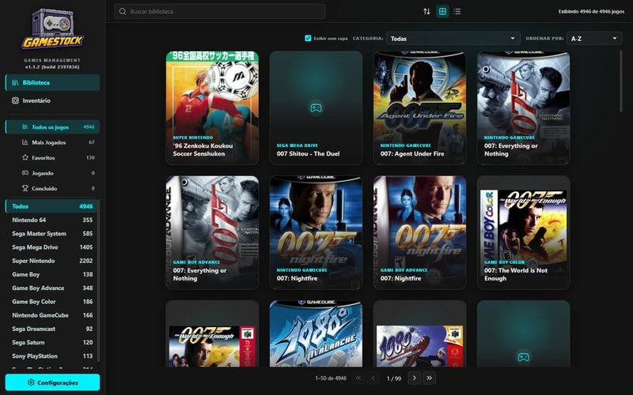
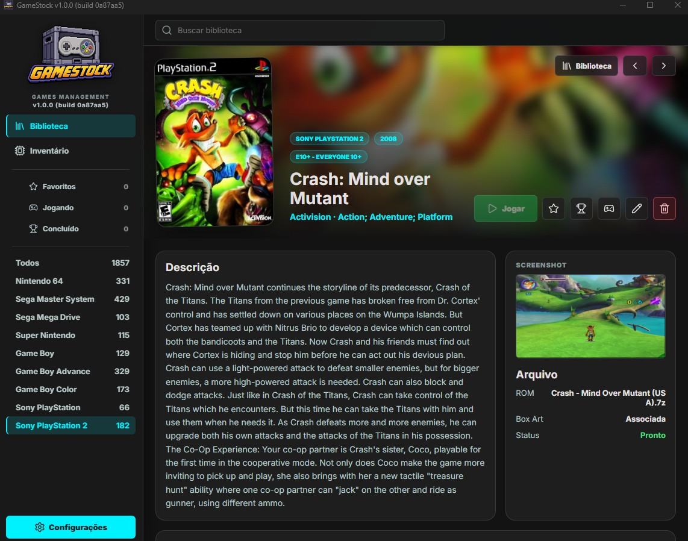
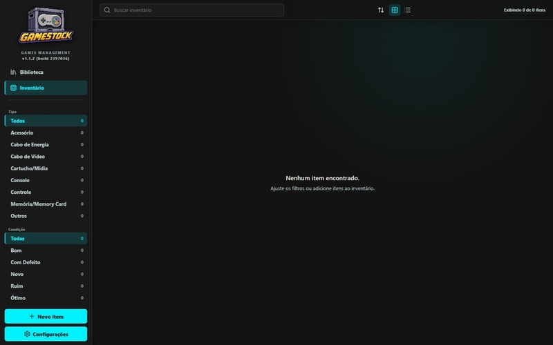
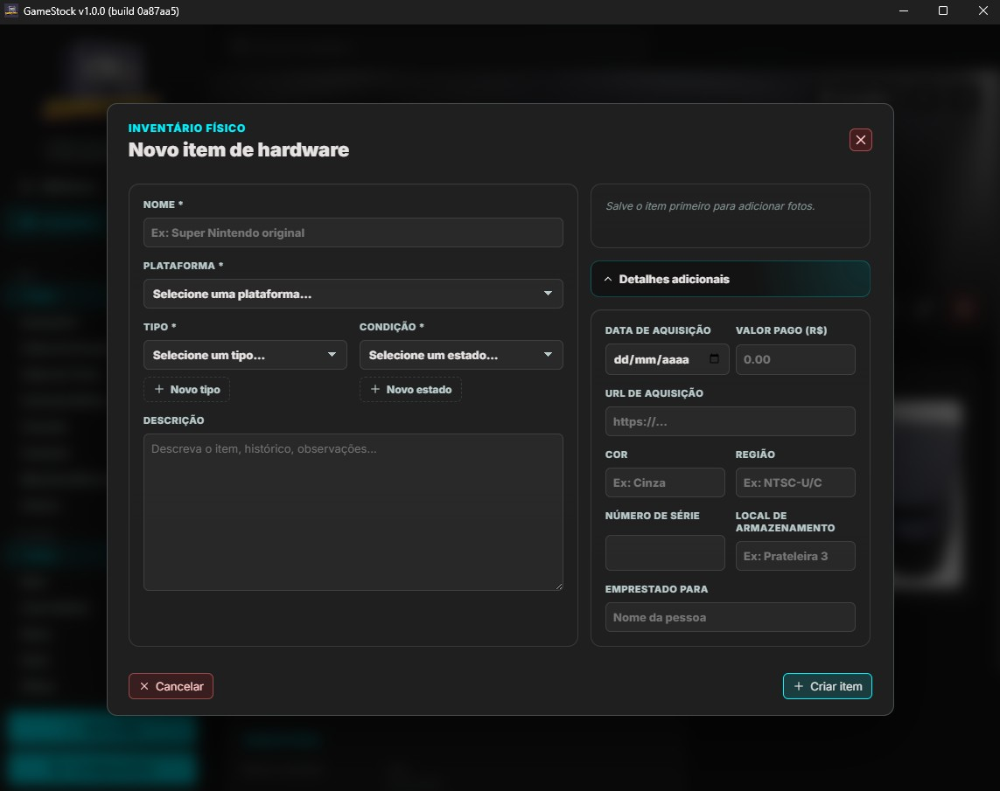
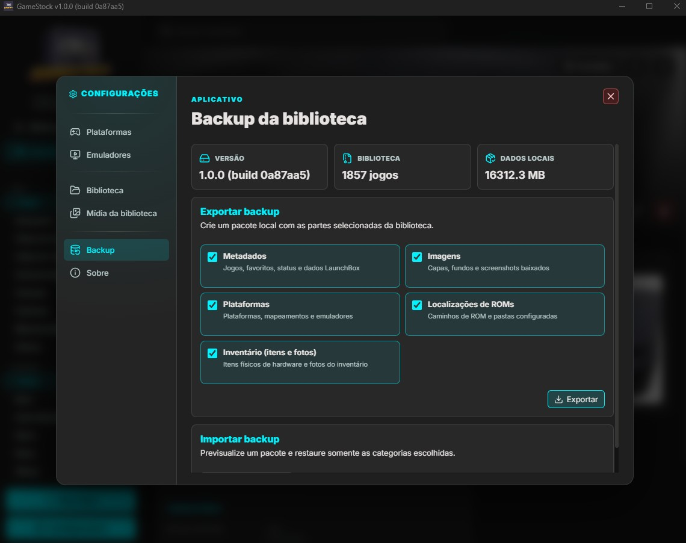

# GameStock

GameStock é um aplicativo desktop para Windows e Linux que organiza bibliotecas de jogos retrô,
ROMs, capas, metadados e inventário físico. O runtime oficial é **C++20 + Qt 6 Quick/QML**, com
SQLite local via QSQLITE. O runtime Electron/React foi retirado do repositório no corte; o backend
congelado em `tools/legacy-runtime/` existe apenas para fixtures e compatibilidade de dados.

Versão atual: **1.1.5**.

## Capturas de tela











## Funcionalidades

- **Biblioteca de jogos**: cadastro, edição, exclusão, favoritos, status e consulta com paginação SQL.
- **Grade e lista**: cards com capas ou lista compacta, com teclado, contadores e ordenação.
- **Detalhe do jogo**: capa, fundo, screenshot, metadados, ROM, versões e formulário.
- **Importação de metadados**: LaunchBox/OpenVGDB/Libretro com cache local, busca e mídia.
- **Filtros e busca**: coleções, plataformas, gêneros e busca em tempo real.
- **Plataformas**: CRUD, aliases de busca e extensões aceitas por plataforma.
- **Emuladores**: CRUD, emulador padrão, vínculos por plataforma e RetroArch com cores.
- **Importação por pasta**: scan, revisão, subpastas, detecção automática e jobs em background.
- **Sincronização de mídia**: capas, fundos e screenshots com progresso e retomada.
- **Notificações de jobs**: cards por status, persistência de transições e dispensa.
- **Inventário físico**: itens, tipos, conservação, fotos, cards/lista, filtros e detalhe.
- **Portabilidade**: backup `.gamestock-backup` ZIP64 com cinco categorias, preview, staging e
  rollback. Compatível com pacotes gerados pelo Electron.
- **Atualizações**: manifesto assinado publicado no GitHub Releases, verificação de SHA-256/tamanho,
  splash com timeout/offline e atualização externa para portátil/Linux.
- **Dados locais**: banco, imagens, cache e geometria da janela no diretório de dados do usuário.

## Instalação

Usuários Windows podem usar:

- `GameStock-<versão>-Setup.exe` — instalador por usuário em
  `%LOCALAPPDATA%\Programs\GameStock`;
- `GameStock-<versão>-Portable.zip` — pasta portátil com `portable.marker`.

O perfil fica em `%APPDATA%\gamestock` (ou `GAMESTOCK_USER_DATA_DIR`) e é preservado na
desinstalação. Não é necessário Node.js, Qt ou Visual Studio para executar.

## Desenvolvimento

Requisitos: Windows 11 + MSVC 2022 x64, CMake 3.25+, Qt 6.8.3 local em
`.native-tools/Qt/6.8.3/msvc2022_64`. Node/npm são usados apenas por ferramentas de fixture,
comparação e assinatura local.

```powershell
cmake --preset windows-msvc -S native
cmake --build native/build/windows-msvc --config Release --parallel 4
$env:PATH = "$PWD/.native-tools/Qt/6.8.3/msvc2022_64/bin;$env:PATH"
ctest --test-dir native/build/windows-msvc -C Release --output-on-failure
powershell -ExecutionPolicy Bypass -File scripts/native-qml-test.ps1
```

Deploy local, instalador e assinatura:

```powershell
powershell -ExecutionPolicy Bypass -File scripts/native-deploy.ps1 -SkipBuild
powershell -ExecutionPolicy Bypass -File scripts/native-installer.ps1 -SkipDeploy
powershell -ExecutionPolicy Bypass -File scripts/native-sign-update.ps1 `
  -PayloadPath update-payload.json -OutputPath latest.json
```

O app abre o perfil real por padrão. Para testes use `--profile-dir` e `--fixture-db` com uma cópia
sintética. O script `scripts/native-run.cmd` inicia o perfil de desenvolvimento.

## Atualizações

O feed é `https://github.com/alexishida/games-stock/releases/latest/download/latest.json`. A chave
privada fica em `%USERPROFILE%\.gamestock\update-signing-key.json`, fora do repositório; apenas a
pública é embutida. A publicação no GitHub é manual.

## Documentação

- [Regras para IA](.ai-framework/RULES.md)
- [Design](.ai-framework/DESIGN.md)
- [Migração nativa](docs/native-migration/)
- [Instalador e portátil](docs/native-migration/installer.md)
- [Atualizações assinadas](docs/native-migration/updates.md)
- [Backup e compatibilidade](docs/native-migration/backup.md)
- [Release/corte](docs/native-migration/release-cut.md)

## Linux

O preset `linux-gcc` existe, mas build, capturas, `.deb` e AppImage continuam adiados por decisão do
usuário. Consulte [linux-deferred.md](docs/native-migration/linux-deferred.md).
